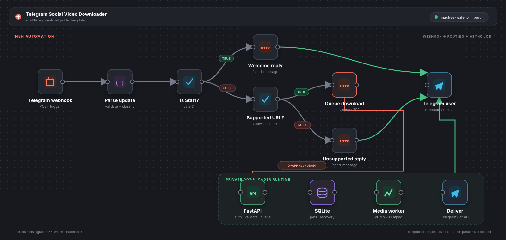

# 📥 Telegram Social Video Downloader

[](https://github.com/dk3yyyy/telegram-social-video-downloader/actions/workflows/ci.yml)

A self-hosted **n8n + FastAPI + yt-dlp** workflow that accepts supported social-video links through Telegram, queues the download, normalizes the media for Telegram, and sends it back to the same chat.

> This is a sanitized, reusable implementation. It contains no production workflow IDs, webhook URLs, bot tokens, chat IDs, credentials, or execution data.

## ✨ What it does

- Receives Telegram webhook updates in n8n
- Recognizes TikTok, Instagram, X/Twitter, and Facebook links
- Handles `/start`, supported links, and unsupported input separately
- Sends jobs to an authenticated FastAPI service over `POST`
- Rejects non-allowlisted submitted hosts and URL credentials before invoking yt-dlp
- Persists job state in SQLite and recovers interrupted jobs after restart
- Deduplicates Telegram updates using `update_id`
- Uses bounded worker and queue limits
- Preserves portrait/landscape dimensions when Telegram receives video metadata
- Transcodes incompatible or oversized video to H.264/AAC when needed
- Keeps the Telegram bot token on the downloader server instead of passing it through workflow requests

## 🧭 Architecture

<p align="center">
  
</p>

The upper canvas mirrors the sanitized n8n workflow in [`workflow/workflow.json`](workflow/workflow.json). Coral connectors cross the authenticated `X-API-Key` boundary into the private runtime; the dashed green path shows media returning directly to Telegram without passing through n8n.

See [`docs/architecture.md`](docs/architecture.md) for trust boundaries and failure behavior.

## 📁 Repository layout

```text
workflow/workflow.json      Sanitized, inactive n8n workflow
downloader/app/             FastAPI service and worker implementation
downloader/tests/           API, queue, URL-validation, and leak tests
docs/                       Architecture, API, security, and troubleshooting
examples/                   Synthetic Telegram update example
docker-compose.yml          Hardened single-instance deployment
.env.example                Required configuration names only
```

## 🚀 Quick start

### Prerequisites

- Docker Engine with Compose v2
- A self-hosted n8n instance that can reach the downloader service
- A Telegram bot token created through [@BotFather](https://t.me/BotFather)
- A public HTTPS URL for the n8n webhook
- n8n 2.31.7 or a compatible maintained release supporting Webhook v2, Code v2, IF v2.2, and HTTP Request v4.2 nodes

### 1. Configure the service

```bash
git clone https://github.com/dk3yyyy/telegram-social-video-downloader.git
cd telegram-social-video-downloader
cp .env.example .env
openssl rand -hex 32
```

Put the generated value in `DOWNLOADER_API_KEY`, add your Telegram bot token, and keep `.env` out of version control. Generate a second, different value for `TELEGRAM_WEBHOOK_SECRET` in the n8n runtime.

Create the private Docker network used between n8n and the downloader:

```bash
docker network inspect automation >/dev/null 2>&1 || docker network create automation
```

Attach your n8n container to this network in its Compose configuration. For an existing container, `docker network connect automation <n8n-container-name>` is a temporary equivalent; declare the network in Compose for a durable setup.

### 2. Start the downloader

```bash
docker compose up --build -d
curl http://127.0.0.1:8080/healthz
```

Expected response:

```json
{"status":"ok"}
```

The compose file binds the host port to localhost and also attaches the service to the external `automation` network. Containers on that network can resolve it as `downloader:8080`. If n8n runs on another host, use a private network or an authenticated TLS reverse proxy instead of exposing port 8080 publicly.

### 3. Configure n8n environment variables

Add these variables to the **n8n runtime** (see [`examples/n8n.env.example`](examples/n8n.env.example)), then restart n8n:

```dotenv
DOWNLOADER_API_URL=http://downloader:8080
DOWNLOADER_API_KEY=the-same-random-key-used-by-the-service
TELEGRAM_WEBHOOK_SECRET=a-separate-random-secret
```

Verify connectivity from the n8n container with `curl http://downloader:8080/healthz`. This export targets self-hosted n8n because it relies on `$env`. On hosted plans that block `$env`, do not activate it unchanged: replace the downloader headers with an n8n Header Auth credential, configure a reachable non-secret base URL, and validate Telegram's secret header at an authenticated reverse proxy.

### 4. Import the workflow

1. In n8n, choose **Import from File**.
2. Select [`workflow/workflow.json`](workflow/workflow.json).
3. Keep it inactive.
4. Change the webhook path from `telegram-social-video-downloader` to a unique random path.
5. Confirm the `TELEGRAM_WEBHOOK_SECRET` environment variable is available to the Code node.
6. Test with n8n's test webhook and the synthetic payload in [`examples/telegram-update.json`](examples/telegram-update.json), including the `X-Telegram-Bot-Api-Secret-Token` header.
7. Review every HTTP Request node and destination.
8. Activate only after the test passes.

### 5. Register the production webhook

After activation, register the workflow's production HTTPS URL with Telegram. Substitute your own values locally; never commit them:

```bash
curl --request POST \
  "https://api.telegram.org/bot${TELEGRAM_BOT_TOKEN}/setWebhook" \
  --data-urlencode "url=${N8N_WEBHOOK_URL}" \
  --data-urlencode "secret_token=${TELEGRAM_WEBHOOK_SECRET}"
```

Verify with `getWebhookInfo` and remove it with `deleteWebhook` if you need to roll back.

## 🧪 Development

```bash
python -m venv .venv
. .venv/bin/activate
pip install -r downloader/requirements-dev.txt
pytest
node scripts/test-workflow-parser.mjs
```

The test suite never calls Telegram, n8n, or social-media sites.

## 🔐 Security model

- `X-API-Key` authentication uses constant-time comparison.
- Only allowlisted social domains are accepted.
- Userinfo, custom ports, fragments, and non-HTTP schemes are rejected.
- Telegram webhook requests require the configured secret header.
- Downloads default to 256 MiB and 30-minute source-duration limits.
- Completed job metadata is retained for seven days by default.
- yt-dlp and ffmpeg run without a shell.
- Tokens are read from environment variables and never accepted in download-job payloads.
- Public artifacts are scanned for token, JWT, production-hostname, and credential-reference patterns.
- The container runs as a non-root user with Linux capabilities dropped.

Read [`SECURITY.md`](SECURITY.md) and [`docs/security.md`](docs/security.md) before exposing the service outside a private network.

## ⚠️ Limitations

- Designed for a **single downloader instance**. SQLite is durable, but it is not a distributed queue.
- Delivery is at-least-once: a crash after Telegram accepts media but before SQLite records success can cause one duplicate delivery after restart.
- yt-dlp follows extractor-selected redirects. Run the container on a network without access to cloud metadata or internal administration services.
- Platform changes can break yt-dlp extraction; keep yt-dlp current and test upgrades.
- Private, age-restricted, DRM-protected, or login-required media is not supported by default.
- Telegram upload limits vary by Bot API deployment and account context. The default service target is intentionally conservative.
- Download only media you are authorized to access and redistribute. You are responsible for platform terms and applicable law.

## 🛑 Disable or roll back

1. Deactivate the n8n workflow.
2. Call Telegram's `deleteWebhook` endpoint or register the previous webhook.
3. Run `docker compose down` to stop the downloader.
4. Keep the named volume if you need job history; use `docker compose down -v` only when you intentionally want to delete it.

## 📄 License

[MIT](LICENSE). Third-party tools and downloaded media remain subject to their own licenses and terms.
